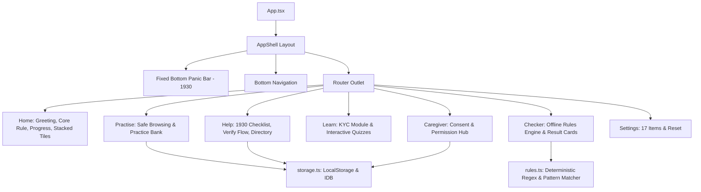

# Architecture & System Design

## 1. Architectural Philosophy
Satark is architected as an offline-first, client-side Progressive Web Application (PWA). Given the vulnerability of the target audience (senior citizens in rural and semi-urban India who may have inconsistent network connectivity or heightened privacy concerns), the system adheres to three non-negotiable principles:
1. **Zero External Dependencies at Runtime**: All fraud pattern detection, localization dictionaries, scenario simulations, and educational content are bundled with the PWA.
2. **Deterministic Security Evaluations**: The message checker does not rely on nondeterministic LLMs or cloud endpoints that could introduce latency, hallucinations, or privacy leaks.
3. **Inclusive Sensory Design**: Multi-modal feedback (large text &ge; 18px, high contrast color coding, audio narration, and visual warning flashes) ensures accessibility for low-vision or digitally hesitant seniors.

---

## 2. Component Architecture

---

## 3. Data Storage & Schema
State persistence is implemented in `src/services/storage.ts`:
- **`dsc_profile`**: Stores user name, age category, phone number, and onboarding status.
- **`dsc_progress`**: Tracks `lessonsCompleted`, `scenariosCompleted`, and `checklistTicks` array.
- **`dsc_settings`**: Stores language (`en`, `hi`, `mr`), theme (`light`, `dark`), text size, and alert toggles.
- **`dsc_caregiver`**: Stores caregiver name, relationship, contact, approval flag, and permission toggles.
- **`dsc_bank_care_number`**: Stores the user's custom bank customer care number locally on their device.
- **`clearAllData()`**: Flushes all `dsc_*` keys and closes/deletes IndexedDB stores upon account deletion.
